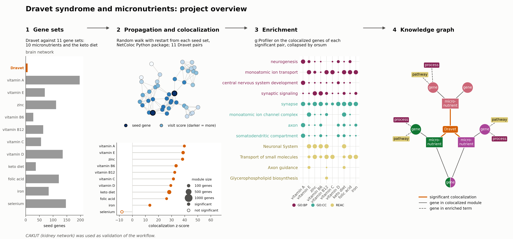
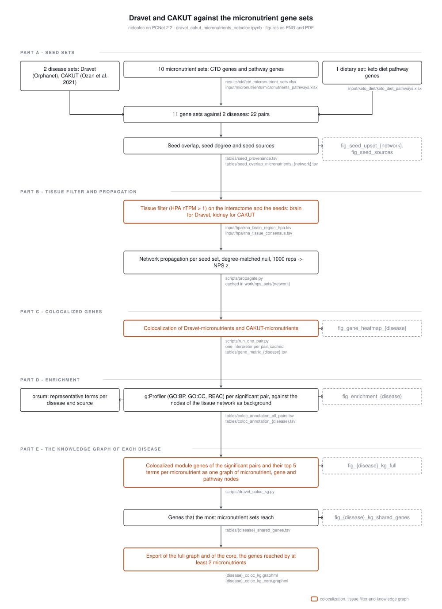

# DS-micronutrients

## Dravet syndrome knowledge graph and micronutrients repository

This repository is a hub for code, tutorials, updates and other resources of
the ERDERA knowledge graph project on Dravet syndrome and micronutrients.



### About this project

The European Research Alliance on Rare Diseases [ERDERA](https://erdera.org/)
connects more than 170 partners in 37 countries. Its Data Service Hub is a
platform to share rare disease data, information and knowledge. The knowledge
graph group (WP 16, Task 16.4) combines existing databases into knowledge graphs
for rare disease understanding, treatment and diagnosis.

## Notebooks

Run the notebooks in this order, from the `notebooks/` folder.

1. `ctd_micronutrients.ipynb` queries the CTD batch query service for ten
   micronutrients and writes `results/ctd/ctd_micronutrient_sets.xlsx`.
2. `dravet_cakut_micronutrients_netcoloc.ipynb` builds the seed sets, runs
   network colocalization of Dravet and CAKUT against each set on PCNet 2.2
   cut to the expressed genes of each disease tissue (brain for Dravet,
   kidney for CAKUT; HPA nTPM > 1), and writes `results/micronutrient_coloc/`.

Each figure is saved as PNG and PDF.



## Environment

Make the environment with [uv](https://docs.astral.sh/uv/):

```bash
uv venv --python 3.12
source .venv/bin/activate
uv pip install -r requirements.txt
python -m ipykernel install --user --name ds-micronutrients
```

orsum is not on PyPI. Install it from bioconda and put `orsum.py` on the
`PATH`:

```bash
conda install -c bioconda orsum=1.8.0
```

### 👉 How to get involved

To give feedback, request a new knowledge graph, give a new input database, or
help in a different way, contact us.

### 💬 Contact

Maastricht University maintains this project.

### License

The code is released under the [MIT License](LICENSE). The input data (CTD,
HPA, PCNet 2.2, HGNC, WikiPathways, KEGG, g:Profiler) keep the terms of their
own sources.
