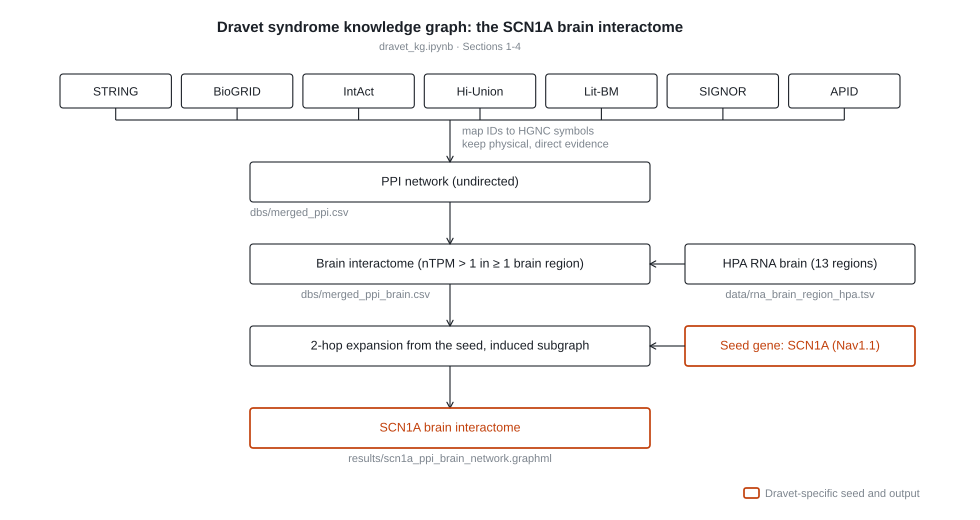

# DS-micronutrients

## Dravet syndrome knowledge graph and micronutrients repository

This website serves as a hub for code, tutorials, updates, and other resources related to the ERDERA Knowledgegraph project on Dravet syndrome and micronutrients. 

### About this project

The European Research Alliance on Rare Diseases [ERDERA](https://erdera.org/) connects more than 170 partners across 37 countries. The Data Service Hub within creates a platform for rare disease data, information and knowledge sharing. The knowledge graph group (WP 16, Task 16.4) strives to create knowledge graphs by combining the knowledge from different existing databases to extract information for rare disease understanding, treatment and diagnosis.  

## The SCN1A brain interactome (`dravet_kg.ipynb`)

Dravet syndrome (severe myoclonic epilepsy of infancy) is a developmental and
epileptic encephalopathy caused in >80% of patients by loss-of-function variants
in **SCN1A**, the gene encoding the Nav</sub>1.1 sodium-channel alpha
subunit. `dravet_kg.ipynb` builds a brain-specific molecular network centred on
SCN1A. 



Seven major databases for protein-protein interactions
are pulled in and filtered for high confidence, direct, physical evidence. Most of the pipelines were access through [pypath](https://github.com/saezlab/pypath). 

| Resource | Access | Version |
| --- | --- | --- |
| STRING | `pypath.inputs.string` | STRING V12.0 |
| BioGRID | `pypath.inputs.biogrid` | BioGRID Version 5.0.260 |
| IntAct | `pypath.inputs.intact` | Release 252 |
| Hi-Union | download from [interactome-atlas.org](https://interactome-atlas.org/) | Luck et al. Nature 2020 |
| Lit-BM | download from [interactome-atlas.org](https://interactome-atlas.org/) | Luck et al. Nature 2020 |
| SIGNOR | `pypath.inputs.signor` | SIGNOR 4.0 |
| APID | manual download | access on August 2026 |

Identifiers (Ensembl protein/gene, UniProt) are mapped to HGNC gene symbols with
`pypath.utils.mapping`. Every resource is cached to `dbs/*.csv` on first run, so
re-running the notebook is fast and offline.


### Running the pipeline

```bash
conda create -n dravet_env python=3.11
conda activate dravet_env
pip install -r requirements.txt

```

**Note** 
APID level 2 (no interspecies) must be downloaded by hand
from [apid.dep.usal.es](http://apid.dep.usal.es/APID/init.action) in 
`data/9606_noISI_Q1.txt`. 

Expect the first notebook execution to take a while
and to need several GB for the pipeline cache; later runs read the cached CSVs in
`dbs/`.

### 👉 How to get involved
If you have any feedback for the website, want to request a new knowledge graph, or provide a new database for input or want to get involved in another way, do not hesitate to reach out. 

### 💬 Contact
This project is maintained by Maastricht University.
